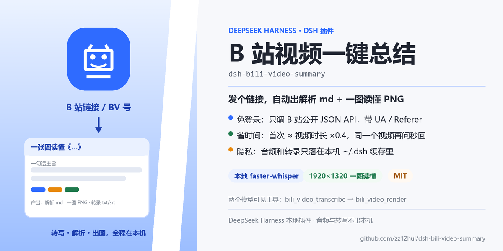
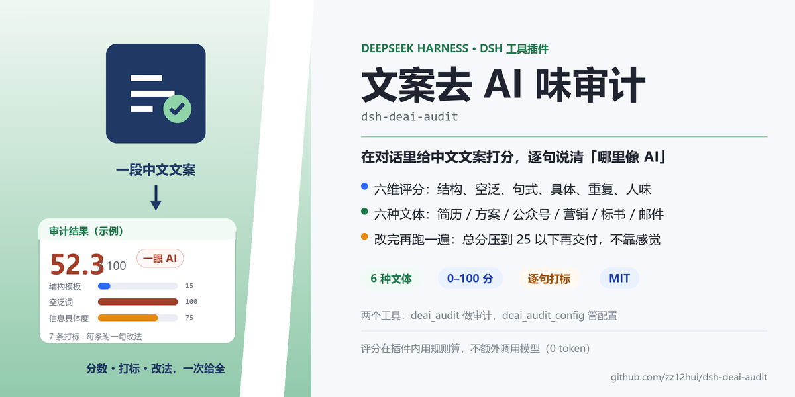
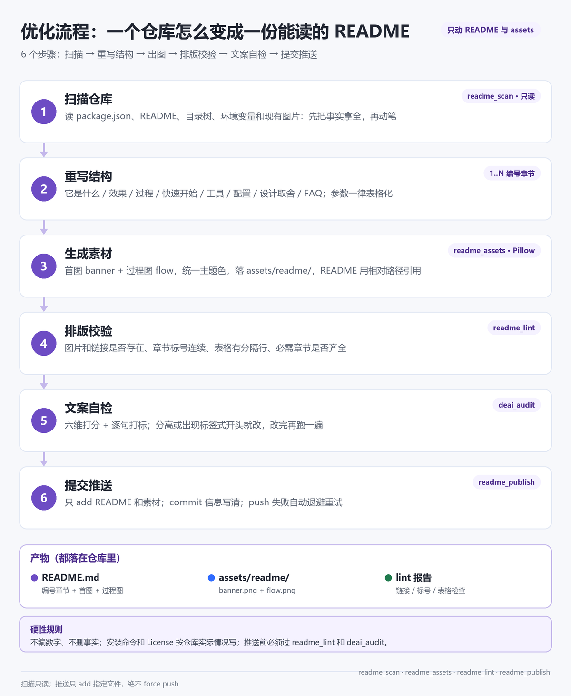
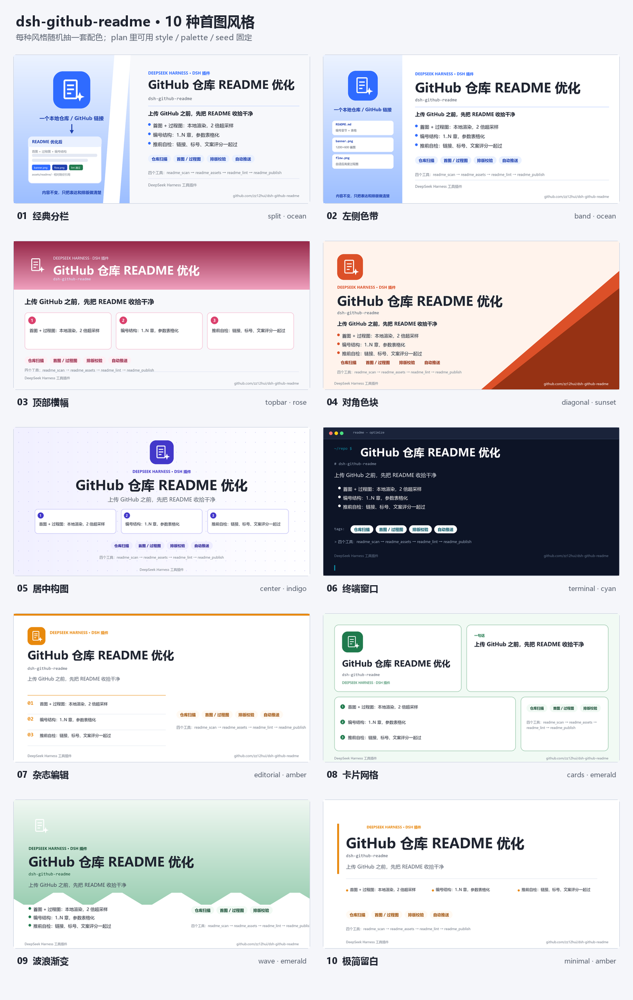

<p align="center">
  
</p>

<div align="center">

[](https://github.com/deepseek-ai/deepseek-harness)
[]()
[]()
[](./LICENSE)

</div>

---

## 1. 它是什么

一个 DSH 工具插件：把「仓库要上 GitHub，README 还是一片乱」这件事变成固定流程。四个工具覆盖四步：先把仓库事实扫出来，按编号骨架重写 README，用 Pillow 出首图和过程图，推之前检查图片链接和章节标号，最后带重试地 commit + push。

用一句话说清楚它管什么：

- 管 **事实**：`readme_scan` 只读仓库，把 package.json、目录树、现有图片、环境变量、git 状态一次拿全，不靠模型记忆编数字。
- 管 **结构**：编号章节 1..N、参数表格化、首图当封面，和 DSH Market 上的仓库保持同一套版式。
- 管 **素材**：`readme_assets` 本地渲染 1200×600 首图和自适应高度的过程图，四种主题色，不依赖在线设计工具。
- 管 **推送**：`readme_publish` 先 `git status` 再看 diff，只提交该提交的；push 遇到网络错误自动退避重试，绝不 force。

## 2. 一次优化长什么样

同一份仓库信息，优化前后差在这几块：

| 位置 | 优化前 | 优化后 |
|---|---|---|
| 首屏 | 直接 `# 项目名` + 一段文字 | 首图 banner + 一行居中 badges |
| 结构 | 想到哪写到哪，没有序号 | `## 1. 它是什么` … `## N. License`，编号连续 |
| 参数 | 大段 bullet 罗列 | 表格：变量 / 默认值 / 作用 |
| 流程 | 一段文字描述 | 过程图 + 编号步骤，两步一一对应 |
| 推送前 | 直接 push | `readme_lint` + `deai_audit` 过了再 push |

这个仓库自己的 README 就是这么生成的：banner 和下面第 4 节的过程图，都是 `readme_assets` 渲染的。

## 3. 案例

这两个仓库是真实用这套流程重做的，点进去可以直接对照：

| [B 站视频总结](https://github.com/zz12hui/dsh-bili-video-summary) | [文案去 AI 味审计](https://github.com/zz12hui/dsh-deai-audit) |
|---|---|
| [](https://github.com/zz12hui/dsh-bili-video-summary) | [](https://github.com/zz12hui/dsh-deai-audit) |

改了什么：

| 项目 | B 站视频总结 | 文案去 AI 味审计 |
|---|---|---|
| 优化前 | README 103 行，无首图、无过程图，章节没有编号 | README 59 行，无首图、无过程图，按功能平铺 |
| 首图 | 蓝色主题，左栏「B 站链接 → 产出小卡」 | 绿色主题，左栏「文案 → 审计结果小卡」 |
| 过程图 | 解析过程 5 步 + 产物条 + 隐私边界 | 审计过程 5 步 + 四档分数 + 设计取舍 |
| 结构 | 11 个编号章节 + 工具/配置/耗时表 | 11 个编号章节 + 六维表 + 六文体权重表 |
| 自检 | deai_audit 12.9 分（很自然） | deai_audit 20.8 分（方案汇报） |
| commit | [772d868](https://github.com/zz12hui/dsh-bili-video-summary/commit/772d868) | [7191cdc](https://github.com/zz12hui/dsh-deai-audit/commit/7191cdc) |

两个案例走的是同一套动作：扫描 → 重写结构 → 出图 → 排版校验 → 文案自检 → 推送。

## 4. 优化流程



对应到工具就是固定顺序：

1. **扫描仓库**（`readme_scan`）：读 package.json、README、两层目录树、现有图片、代码里的环境变量、git remote/分支/改动。只读，不改任何文件。
2. **重写结构**：按 [`references/README-模板.md`](./references/README-模板.md) 的编号骨架填内容；不适用的小节删掉，编号保持连续。
3. **生成素材**（`readme_assets`）：给一份 plan，渲染 `banner.png` 和 `flow.png` 到 `assets/readme/`。首图有 10 种风格、每种 5–6 套配色，不指定就随机组合；图片是 2 倍超采样后缩放的，中文用微软雅黑，避免糊。
4. **排版校验**（`readme_lint`）：查图片/相对链接是否存在、`## N.` 编号是否连续、表格有没有 `|---|` 分隔行、必需章节和首图是否齐全。
5. **文案自检**（`deai_audit`）：六维打分 + 逐句打标，先看「标签式开头 / 空泛词 / 一眼 AI」三类，改完复检到 25 分以下。
6. **提交推送**（`readme_publish`）：先 `dryRun` 看 diff stat，再正式 add → commit → push。

## 5. 四个工具

| 工具 | 做什么 | 关键参数 |
|---|---|---|
| `readme_scan` | 扫描仓库事实，给写 README 用 | `path`（本地仓库）或 `url`（GitHub 地址，会浅克隆） |
| `readme_assets` | 渲染首图 / 过程图（10 种首图风格，随机配色） | `plan`（必含 `outDir`；`style`、`palette`、`seed`、`banner`、`flow` 见下） |
| `readme_lint` | README 排版体检 | `path`（README.md 或仓库根）；`required`（必需章节关键词） |
| `readme_publish` | commit + push（带重试） | `path`、`message`；可选 `branch`、`files`、`dryRun`、`retries` |

`readme_assets` 的 plan 大致长这样（完整字段见 [`references/素材-plan示例.json`](./references/素材-plan示例.json)）：

```json
{
  "outDir": "<仓库根>/assets/readme",
  "style": "split",
  "palette": "violet",
  "seed": 42,
  "banner": {
    "title": "GitHub 仓库 README 优化",
    "mono": "dsh-github-readme",
    "headline": "上传 GitHub 之前，先把 README 收拾干净",
    "bullets": ["首图 + 过程图：Pillow 渲染", "编号结构 1..N", "推前自检"],
    "chips": [{ "text": "仓库扫描" }, { "text": "首图 / 过程图", "color": "blue" }],
    "leftTop": "一个本地仓库 / GitHub 链接",
    "leftCard": { "title": "README 优化后", "chips": ["banner.png", "flow.png", "lint 通过"] }
  },
  "flow": {
    "title": "优化流程：一个仓库怎么变成一份能读的 README",
    "subtitle": "6 个步骤：扫描 → 重写 → 出图 → 校验 → 自检 → 推送",
    "steps": [{ "title": "扫描仓库", "tag": "readme_scan", "desc": "读事实，不改文件" }]
  }
}
```

`style` / `palette` / `seed` 都可以省：省掉 style 就随机风格，省掉 palette 就在该风格的配色里随机，seed 用来复现同一张图。

## 6. 默认规则：上传 GitHub 前自动走这套

插件仓库里带了一份技能 `github-readme-optimize`（`skill/` 目录）。装好后，DSH 在遇到「上传 GitHub / 推仓库 / 发插件 / 优化 README」这类任务时会按这套流程执行。

想让它对所有会话默认生效，把下面这段加进 `~/.dsh/AGENTS.md`：

```markdown
## GitHub 上传前默认优化 README

- 只要要往 GitHub 推内容（新建仓库、git push、发布插件），先按 `github-readme-optimize` 技能优化 README 再推。
- 顺序：readme_scan → 写编号 README → readme_assets 出图 → read_image 自查 → readme_lint → deai_audit → readme_publish。
- 工具没加载（旧会话）：直接跑 `~/.dsh/profiles/desktop/node_modules/dsh-local-github-readme/scripts/render_readme_assets.py`。
- 例外：用户明确说「先别改 README，直接推」。
```

## 7. 快速开始

### 6.1 前置条件

- **Windows 10 / 11**：图片渲染用的是系统自带微软雅黑（`C:\Windows\Fonts\msyh.ttc`），其他系统要改字体路径。
- **DSH 桌面版**：已实测 **0.2.1-rc.2**，需要支持 `ctx.tools` 工具注册的版本。
- **Python + Pillow**：优先用 DSH 自带 Python 运行时（自带 Pillow）；也可用 `GITHUB_README_PYTHON` 指定解释器。
- **git**：`readme_publish` 用本机 git 和已保存的凭据推送。

### 6.2 安装插件

命令行走 profile 的插件管理器安装（DSH 桌面版一般用 `desktop`，dsh web 用 `web`）：

```bash
dsh plugin --profile desktop add github:zz12hui/dsh-github-readme
```

> DSH 桌面版正在运行时，命令行不会改应用的 profile：先退出桌面版再执行，或等上架后在市场里一键安装。

装完**重启 DSH**（关闭窗口含托盘退出 → 重开 → 恢复会话）。想让「上传 GitHub 前默认优化 README」对所有会话生效，再装技能、加 AGENTS.md 规则，见下面第 3、4 条。

<details>
<summary>手动安装（旧版 / 离线环境）</summary>

```bash
git clone https://github.com/zz12hui/dsh-github-readme.git
```

1. 把仓库内容复制到 `%USERPROFILE%\.dsh\profiles\desktop\node_modules\dsh-local-github-readme\`。目录名保持 `dsh-local-github-readme`（和 `package.json` 的 `name` 一致）。
2. 在 `%USERPROFILE%\.dsh\profiles\desktop\cordis.patch.yml` 末尾追加：

   ```yaml
   - insert:
       - id: github-readme-panel
         name: 'dsh-local-github-readme'
   ```

3. 装技能（可选但推荐）：把 `skill/` 下的内容复制到 `%USERPROFILE%\.dsh\skills\github-readme-optimize\`；用 `dsh plugin add` 装的，`skill/` 在 `%USERPROFILE%\.dsh\profiles\desktop\node_modules\dsh-local-github-readme\skill\`。
4. 在 `~/.dsh/AGENTS.md` 末尾加上第 6 节的默认规则。
5. **重启 DSH**（关闭窗口含托盘退出 → 重开 → 恢复会话）。插件和技能都在启动时加载，刷新页面不会加载它们。

</details>

### 6.3 验证

重启后让助手「扫一下这个仓库的 README 情况」，应该看到 `readme_scan` 被调用；再让它「给这个仓库出首图和过程图」，应该调用 `readme_assets`。

## 8. 素材规范

首图有 10 种风格，每种自带 5–6 套配色；调用时不指定 `style` / `palette` 就随机组合，返回里会带上实际用的 `style`、`palette`、`seed`，用同一个 `seed` 能复现同一张图。



| # | 风格 id | 名称 | 适合 |
|---|---|---|---|
| 01 | `split` | 经典分栏 | 通用款，左栏图标 + 小卡，右栏标题与卖点 |
| 02 | `band` | 左侧色带 | 工具类，左栏列文件清单 |
| 03 | `topbar` | 顶部横幅 | 内容多，卖点拆成三张卡片 |
| 04 | `diagonal` | 对角色块 | 想要强视觉记忆点 |
| 05 | `center` | 居中构图 | 品牌型项目，图标标题居中 |
| 06 | `terminal` | 终端窗口 | 开发者工具 / CLI |
| 07 | `editorial` | 杂志编辑 | 文档型项目，大标题 + 编号条目 |
| 08 | `cards` | 卡片网格 | 信息多，四格各管一摊 |
| 09 | `wave` | 波浪渐变 | 偏产品 / 创意 |
| 10 | `minimal` | 极简留白 | 标题是主角，克制 |

配色 10 套：`ocean` 蓝 / `emerald` 绿 / `violet` 紫 / `amber` 琥珀 / `rose` 玫红 / `cyan` 青 / `indigo` 靛蓝 / `slate` 石板灰 / `lime` 青柠 / `sunset` 落日橙。

| 项 | 规范 |
|---|---|
| 首图 | 1200×600 PNG；10 种风格，每种 5–6 套配色；默认随机 |
| 随机规则 | 不传 `style` → 随机风格；不传 `palette` → 该风格可选配色里随机；`seed` 固定组合 |
| 过程图 | 宽 1200，高度随步骤数自适应（3–6 步），配色跟随同一套 palette |
| 旧字段兼容 | `theme`（blue/green/violet/orange）自动映射到对应配色 |
| 图标 | `play` / `check` / `doc` / `branch` / `bolt` / `puzzle` 六种内置字形 |
| 输出 | `assets/readme/banner.png`、`flow.png`，README 用相对路径引用 |

换风格后想看看全部效果，直接跑渲染器：`--gallery out.png` 出总览图，`--list-styles` 打印风格与配色清单。

## 9. 配置与目录

| 变量 | 默认值 | 作用 |
|---|---|---|
| `GITHUB_README_HOME` | `~/.dsh/github-readme` | 数据根目录（克隆缓存、渲染临时文件） |
| `GITHUB_README_PYTHON` | DSH 自带 Python | 指定渲染用的解释器 |

```text
dsh-github-readme/
├── index.js                     # apply(ctx) 注册 4 个工具；扫描/校验/推送逻辑
├── cordis.patch.yml             # DSH 启动时的插件注册行
├── scripts/render_readme_assets.py  # 首图 / 过程图渲染器（Pillow，2x 超采样）
├── references/
│   ├── README-模板.md            # 编号章节骨架 + 推送前检查清单
│   └── 素材-plan示例.json         # readme_assets 的 plan 模板
├── skill/                       # 配套技能 github-readme-optimize
├── locale/                      # 插件清单里的中文名和描述
├── assets/readme/               # 本仓库自己的首图与过程图
├── icon.svg
└── package.json
```

## 10. 设计取舍

1. **扫描只读**：`readme_scan` 不改任何文件，克隆也落在 `~/.dsh/github-readme/repos`，不污染工作区。模型先拿事实，再动笔。
2. **图片本地渲染**：不调在线设计工具，Pillow 直接画，2 倍超采样后缩小；字体用系统雅黑，中文不会变方块。
3. **lint 用正则而不是 Markdown 解析器**：只查真正会翻车的项——图片/链接目标是否存在、编号是否连续、表格有没有分隔行、首图是否在首屏。够用，且零依赖。
4. **push 带退避重试**：本机访问 GitHub 时好时坏，网络类错误自动重试 3–4 次；认证类错误直接报错，不做无意义重试。
5. **绝不 force push**：工具只做 `git add` / `commit` / `push origin HEAD:branch`，没有 `--force` 参数。

## 11. 卸载与回滚

删掉 `cordis.patch.yml` 末尾的 `github-readme-panel` 插入块和 `node_modules\dsh-local-github-readme` 目录；技能删掉 `~/.dsh/skills/github-readme-optimize`；`AGENTS.md` 里的默认规则按需删除。重启 DSH 后工具消失。数据目录 `~/.dsh/github-readme` 可保留（克隆缓存），也可整个删掉。

## 12. 常见问题

**重启后工具没出现？** host 插件只在 DSH 启动时注册，必须关闭窗口含托盘退出再重开，刷新页面不算。

**渲染报错找不到模块？** 说明用的 Python 没装 Pillow。优先让它用 DSH 自带 Python，或用 `GITHUB_README_PYTHON` 指向装了 Pillow 的解释器。

**push 一直失败？** 看 `readme_publish` 返回的 `error`：认证问题先确认本机 git 凭据（`git push` 能推才行）；网络问题会自动重试，仍失败就手动重跑。

**首图上的标题被截断？** 渲染器会自动缩字号，但标题最好控制在 12 个汉字以内；长标题改成短标题 + 副标题。

**想固定首图风格？** plan 里传 `style` + `palette`（可选 `seed`），返回值会带上实际使用的组合；不传就每次随机，适合一仓一图不重样。

**能新建 GitHub 仓库吗？** 不能。`readme_publish` 只推已有的 remote；新建仓库请在 GitHub 网页或 `gh` 里做。

## 13. License

[MIT](./LICENSE) © 2026 zz12hui
